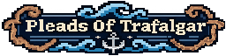
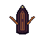
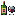
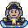
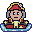
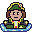

<div align="center">



### _October 21, 1805. The fleet is burning. Six hundred men were left behind._

🏆 **Winner of the GO2026 school game jam**




</div>

---

## About

**Pleads of Trafalgar** is a top-down pixel-art survival game about the night after the Battle of Trafalgar.

You were a French captain. When your ship went down you took a lifeboat and rowed away. Now the fleet's three generals are drifting somewhere in the dark water, and the British are hunting anything that floats.

Row through the night, keep your lantern burning, and find the generals before they drown. Once you have all three, the last general's compass points you to a second fleet waiting beyond the fog.


## Features

- **Light is your lifeline and your weakness.** Your lantern lets you see, but the British see it too. Put it out when they get close.
- **Fuel management.** Collect driftwood to keep the flame alive. Watch out for wet wood.
- **Sunken chests.** Open floating chests for food and supplies, and drag items between the chest and your hotbar.
- **Three generals to rescue,** each with their own voice lines. They call out to you, and they get desperate as they start to drown.
- **An enemy ship** that hunts you down and fires when it spots you.
- **A compass** that leads you to the French fleet and your escape.
- **Positional audio,** a full voice cast and an original main theme.

## Controls

| Key                                    | Action                       |
| -------------------------------------- | ---------------------------- |
| <kbd>W</kbd> / <kbd>↑</kbd>            | Row forward                  |
| <kbd>S</kbd> / <kbd>↓</kbd>            | Row backward                 |
| <kbd>A</kbd> / <kbd>←</kbd>            | Turn left                    |
| <kbd>D</kbd> / <kbd>→</kbd>            | Turn right                   |
| <kbd>E</kbd> / <kbd>M</kbd>            | Open chest or rescue general |
| <kbd>F</kbd> / <kbd>N</kbd>            | Lantern on/off               |
| <kbd>Space</kbd>                       | Use selected item            |
| <kbd>1</kbd> <kbd>2</kbd> <kbd>3</kbd> | Select hotbar slot           |
| <kbd>Esc</kbd>                         | Close chest                  |
| Mouse                                  | Drag and drop items          |

## Items

|                                                      | Item       | Effect                     |
| :--------------------------------------------------: | ---------- | -------------------------- |
|    | Dry Wood   | Refuels the lantern        |
|    | Wet Wood   | Drains fuel, don't burn it |
|   | Croissant  | +15 HP                     |
|  | Dried Meat | +20 HP                     |
|    | Baguette   | +25 HP                     |
|        | Wine       | +45 HP over 7 seconds      |

## The Generals

<table align="center">
  <tr>
    <td align="center"><br /><b>Pierre-Charles Villeneuve</b></td>
    <td align="center"><br /><b>Jean-Jacques-Étienne Lucas</b></td>
    <td align="center"><br /><b>Pierre Dumanoir le Pelley</b></td>
  </tr>
</table>

## Running locally

The game is plain JavaScript with ES modules, so there is nothing to install or build. Modules don't load over `file://`, so you need a local web server:

```bash
git clone https://github.com/Collbrothers/go2026.git
cd go2026
python -m http.server
```

Then open <http://localhost:8000> in your browser. Any static server works, such as `npx serve` or the Live Server extension in VS Code.

## Built with

- Vanilla JavaScript (ES modules), no frameworks
- HTML5 Canvas, rendered at 640×360 and scaled up for crisp pixels
- Hand-drawn pixel art and original audio

## Team

| Name            | Role             |
| --------------- | ---------------- |
| Aron Kylebäck   | Programmer       |
| Robin Karlsson  | Programmer       |
| Oliwer Sandberg | Sound Designer   |
| Mátyás Dioszegi | Game Designer    |
| Léon Maars      | Graphic Designer |
| Hala Srhan      | Graphic Designer |
| Anton Grundvall | Voice Actor      |

### Sound credits

**juanlopz08** (rowing), **klankbeeld** (waves), **DRAGON-STUDIO** (chest), **Alice_soundz** (fuel), **freesound_community** (shot, whispers and low fuel), **A_a2005** (consumables), **HugoBozz** (breathing) and **Universfield** (cannon and damage).

---

<div align="center">
<sub>Made in two weeks for GO2026</sub>
</div>
